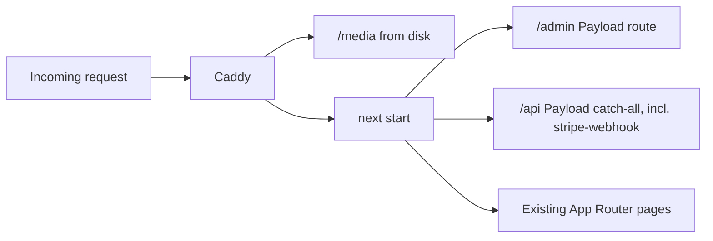

# Payload 2 to 3 migration

Move this app from Payload 2.30 on a custom Express server to Payload 3.94 on Next.js, preserving the public URLs, checkout, webhooks, media, admin customizations, and stored content. Rich text moves to Lexical in the same project so the later Payload 4 upgrade does not have to redo it.

Target the current stable line: **Payload 3.94.1**, **Next.js 16.4.6** (minimum 16.4.5), **React 19.2** in the peer range Payload accepts (the patched `~19.2.9` line), **Node `^22.23.5` or newer supported by 3.94**. Stay on MongoDB. Do not install Payload 4.

Payload 3 deletes the Express admin/API server. The public site already lives in the App Router, so the frontend routes stay; the process that serves them changes.

## Checklist

- [ ] Pin Payload 3.94.1, Next 16.4.6, React 19.2, and Node 22.23.5+; check React 19 support in UI dependencies; back up Mongo
- [ ] Replace the Express server with withPayload route handlers, next dev/build/start, and instrumentation cron
- [ ] Serve `/media` from Caddy; keep the Stripe webhook as a Payload endpoint reading the raw body
- [ ] Port custom endpoints, audio upload, email adapter, and loginAfterCreate to the Payload 3 request API; drop `rateLimit`
- [ ] Remove the dead `/api/audio` and `/api/sounds` Next routes so they do not shadow Payload
- [ ] Convert config and scripts to ESM (`__dirname`, `payload run`)
- [ ] Run the MongoDB `relationships-v2-v3` migration
- [ ] Move rich text to Lexical (button becomes a link with `appearance: 'button'`), then migrate stored Slate JSON
- [ ] Fix Next 16 and React 19.2 breakages in the existing App Router site
- [ ] Rehearse the whole sequence on a copy of production, then verify pages, admin, preview, media, checkout, webhook, cron endpoints, and production build

## What must keep working

- Public paths: `/`, `/[slug]`, `/admin`, `/api/*`, `/media/*`, `/next/preview`, `/next/revalidate`, `/next/exit-preview`.
- Checkout: `POST /api/checkout/ticket-buyer-questions`, `POST /api/create-payment-intent`, `GET /api/payment-status`, `POST /api/ensure-order-created`.
- Stripe webhook signature checks on the raw body (`src/server.ts` lines 20–22, `src/payload/endpoints/stripeWebhook.ts`).
- Cron loop that hits ticket sync and fee backfill (`src/payload/services/stripeTicketSalesCron.ts`).
- Cookie `payload-token`, `Authorization: JWT …`, and `users API-Key …` used by `src/app/_api` and the dashboard.
- Upload URLs under `/media` from `MEDIA_DIR`, including `/media/audio/...` (`src/payload/collections/Media.ts`, `src/payload/collections/Audio/index.ts`).
- Admin audio uploads through Payload's own `POST /api/audio`.
- Deploy health check `GET /api/health` on port 3000 (green stays on 3001).
- Relationship filters on existing data: sales to releases/merch, ticket sales to events, links to pages/documents.
- Slate content already in Mongo, including the custom `button` element (`src/payload/fields/richTextButton/index.ts`), rendered by `src/app/_components/RichText/serialize.tsx` and `src/payload/utils/ticketEmailFooter.ts`.

Leave unused packages unwired: `@payloadcms/plugin-seo`, `plugin-redirects`, and `plugin-nested-docs` are in `package.json` but not in `src/payload/payload.config.ts`. Turning redirects on would change routing. Remove them after confirming `redirects.js` still tolerates a missing `/api/redirects`.

## 1. Runtime, branch, and rollback

- Work on a migration branch. Take a full Mongo backup before the relationship migration, before any admin save of rich text, and again before the Lexical write script.
- Both database migrations (relationships, then Lexical) only go one way. Rolling back to v2 means restoring the backup and redeploying the previous build. Rehearse the full sequence end to end on a copy of production before touching the live database.
- Raise Node everywhere the app runs: local, CI, and the deploy host. `Dockerfile` is `node:18.8-alpine` and points at a stale `dist/payload.config.js`; update it to the new `next start` entry and Node 22, or treat it as unused if production is only PM2 via `scripts/deploy.sh`.
- Pin Payload, `@payloadcms/*`, Next `16.4.6`, and React 19.2 to the same 3.94.1 set: `payload`, `@payloadcms/next`, `@payloadcms/db-mongodb`, `@payloadcms/richtext-lexical`, `@payloadcms/email-nodemailer`, `@payloadcms/ui`, `graphql`, `sharp`. Drop `@payloadcms/bundler-webpack`, `@payloadcms/richtext-slate`, the Slate pins, and `express` once nothing imports them.
- Check React 19 support before bumping: `use-shopping-cart`, `react-h5-audio-player`, `hamburger-react`, `@paypal/react-paypal-js`, `yet-another-react-lightbox`, `react-hot-toast`, `@stripe/react-stripe-js`. Upgrade or replace any that cap React at 18. Remove `react-router-dom` if nothing imports it.

## 2. Make Next the server

Replace `src/server.ts` and delete `src/server.default.ts`. Payload 3 boots through Next.

- Wrap `next.config.js` with `withPayload`.
- Add the generated route handlers: `src/app/(payload)/admin/[[...segments]]/page.tsx`, `src/app/(payload)/api/[...slug]/route.ts`, and the matching `layout.tsx` / `custom.scss` from a fresh `create-payload-app` (Mongo template), then point them at the existing config. Add the `@payload-config` path alias in `tsconfig.json`.
- Move `secret` from `payload.init` into the config. Delete `admin.bundler` and `admin.webpack`. Pass `sharp` into `buildConfig`.
- Import `buildConfig` from `payload`, not `payload/config`. Collection types come from `payload`.
- Delete the `rateLimit` block. Payload 3 removed rate limiting. If limits are still wanted, add them in Caddy; keep exempting the `users API-Key` SSR fetches and `/api/stripe-webhook` there too.
- Admin components become **file path strings** with `'use client'` where they use hooks. That covers `src/payload/components/Logo.tsx`, `Icon.tsx`, `SyncBandcampButton.tsx`, and `AudioSelectField.tsx`. Replace `payload/components/*` imports with `@payloadcms/ui`.
- Register email with `nodemailerAdapter` using the current SMTP env (`SMTP_HOST`, `SMTP_USER`, `SMTP_PASS`, `defaultFromName: 'SHUSH'`, `defaultFromAddress: 'hello@shush.dance'`).
- Scripts: `dev` becomes `next dev`; `build` becomes `next build`; `serve` / `serve-green` become `PORT=3000 next start` and `PORT=3001 next start`. Set `PORT` in the environment rather than passing `-p`, because the cron reads `process.env.PORT` to call its own endpoints. Next 16 uses Turbopack for both dev and build, so do not add `--turbopack` or `--webpack`. `next.config.js` has no custom webpack function. If `withPayload` injects one and `next build` refuses to start, follow the Payload 3.94 Next 16 template rather than opting out. Remove `PAYLOAD_CONFIG_PATH`, `build:payload`, and `build:server`. The temporary build listener on port 3999 goes away because `next build` loads Payload itself. The build host still needs `DATABASE_URI` and `PAYLOAD_SECRET`. Concurrent `next dev` and `next build` in one directory can corrupt the Turbopack cache; the deploy build must not run beside a live dev server on the same checkout.
- Start the Stripe ticket cron from `src/instrumentation.ts`. Only run it when `NEXT_RUNTIME === 'nodejs'`. Replace the `NEXT_BUILD` guard with a check for `NEXT_PHASE` being the build phase, and keep `STRIPE_TICKET_SYNC_CRON_ENABLED=false` support. Keep calling the existing localhost endpoints so behavior stays the same.

## 3. ESM config and scripts

Payload 3 runs as ESM. `__dirname` is not defined there.

- `src/payload/payload.config.ts`: build `typescript.outputFile` from `fileURLToPath(import.meta.url)`.
- `src/payload/collections/Audio/index.ts`: `staticDir` is `path.resolve(__dirname, '../../../../media/audio')`. Resolve it from `getMediaRoot()` in `src/payload/paths.ts` so it stays on the shared media disk.
- Check `src/payload/paths.ts` itself for `__dirname`.
- Move the scripts that boot Payload through `PAYLOAD_CONFIG_PATH` or ts-node to `payload run`: `migrateEventTicketTiers.ts`, `exportCatalog.ts`, `fixMediaUrls.ts`, `backfillStripeFees.cjs`, `exportEvents.cjs`, `exportCatalog.cjs`, `exportProducts.cjs`. Update their `package.json` entries.

## 4. `/media`, Stripe webhook, and dead API routes

Payload 3 serves uploads at `/api/<collection>/file/<filename>` and drops `staticURL`. Existing files and stored URLs use `/media/...`.

- Keep `staticDir` as an absolute path from `MEDIA_DIR` or the repo `media` folder (`src/payload/paths.ts`) for Media, Audio, and Documents.
- Serve `/media/*` from Caddy with a `file_server` rooted at the shared media folder (`/home/lando/shush/media`, the target of the symlink in `scripts/deploy.sh`). That keeps every existing URL, gives audio range requests for seeking, and keeps file traffic off Node. Update the Caddy config for both blue and green ports. For local dev without Caddy, set `NEXT_PUBLIC_MEDIA_URL` to production, which `src/app/_utilities/getMediaUrl.ts` already supports.
- Media docs returned by the API will report `url` as `/api/media/file/...`. `resolveMediaUrl` should prefer `filename` and build `/media/...` so the frontend keeps the same URLs.
- Keep the Stripe webhook as a Payload endpoint at `/stripe-webhook`. Payload 3 does not parse custom endpoint bodies in advance, so `await req.text()` returns the raw body for `stripe.webhooks.constructEvent`. Do not call `addDataAndFileToRequest` in that handler.
- Delete `src/app/api/audio/route.ts`, `src/app/api/sounds/route.ts`, and `src/app/_api/uploadSound.ts`. Under Express they were never reached because Payload handled `/api/*` first. In Payload 3 an exact Next route beats Payload's catch-all, so `POST /api/audio` (admin audio upload) would hit the proxy route, which forwards to a `/api/audio/upload` that does not exist. `/api/sounds` also points at a collection that does not exist.

## 5. Port endpoints and hooks

Rewrite every handler in `src/payload/endpoints` and the Audio `custom-upload` endpoint from `(req, res)` to Payload 3’s `(req) => Response`. Same paths, methods, and auth checks:

- Read JSON bodies with `await req.json()` (or `addDataAndFileToRequest`), query params from `req.searchParams`, and headers with `req.headers.get()`.
- Public checkout and payment endpoints stay unauthenticated.
- `x-api-key` checks stay on monitor, ticket sync, fee backfill, and the public tracker.
- `sync-bandcamp` stays callable from the admin button with the session cookie.
- Audio upload reads the file through `addDataAndFileToRequest` (`req.file`) instead of `req.files`.
- `createPaymentIntent` stops using `req.ip` and `req.connection`; read the client IP from `x-forwarded-for` set by Caddy.

Update `src/payload/collections/Users/hooks/loginAfterCreate.ts`: `payload.login` no longer takes an Express `res`. Return the token the same way the API does today so a user created without a session still receives a logged-in response.

Update the Pages `admin.livePreview.url` and `admin.preview` functions to the Payload 3 arguments (`{ data, collectionConfig }`). Bump `@payloadcms/live-preview-react` with Payload. Preview and revalidate routes stay; align the draft secret so Pages admin preview and `src/app/next/preview/route.ts` read the same env var (`NEXT_PRIVATE_DRAFT_SECRET` vs `PAYLOAD_PUBLIC_DRAFT_SECRET` is currently split).

Regenerate `src/payload/payload-types.ts` with `payload generate:types` after the config compiles. Fix import sites that depend on the old type shape.

## 6. MongoDB relationship IDs

Payload 3 stores relationship and upload IDs as ObjectIDs. The v2 data stores them as strings. Without this step, relationship filters (sales by release or merch, ticket sales by event, admin list filters) silently return nothing while documents still open fine.

- After the config compiles on 3.x and before the Lexical step, run:
  - `payload migrate:create --file @payloadcms/db-mongodb/relationships-v2-v3`
  - `payload migrate`
- This also rewrites versions for `pages`, `releases`, and `merch`, and the `socials` global.
- Commit the generated migration file. Check a few relationship queries in admin and on the dashboard afterward.

## 7. Rich text: Slate JSON to Lexical

Do this inside the v3 migration. Slate still runs on 3.x but is removed in 4.0, and the stored JSON is not the same format.

- Replace `slateEditor` in `src/payload/payload.config.ts`, `src/payload/fields/createRichTextField.ts`, and `src/payload/collections/Media.ts` with `lexicalEditor`.
- Recreate the toolbar set the field has now: headings, link, lists, quote, bold, italic.
- Convert the custom **button** into a regular Lexical link with one extra field, `appearance: 'link' | 'button'`, added through `LinkFeature({ fields })`. The button's fields (`linkType`, `url`, `doc`, `newTab`, `label`) already mirror the link fields in `src/payload/fields/richTextLinkFields.ts`, and Lexical links support internal `pages` / `documents` docs. This removes the custom Slate plugin, toolbar, element, and drawer in `src/payload/fields/richTextButton/`.
- Add `SlateToLexicalFeature` with a custom converter for the Slate `button` node that emits a link node with `appearance: 'button'` and the button `label` as its text. Preview on read first (`afterRead` conversion, no writes). Confirm admin, `src/app/_components/RichText/serialize.tsx`, and ticket-email HTML.
- Lexical populates internal link docs itself, so `src/payload/fields/populateRichTextButtons.ts` and its `afterRead` hook can go once buttons are links.
- Then back up Mongo, set `disableHooks: true`, and run `migrateSlateToLexical`. Only after that, save documents in admin.
- Point the site serializer and the email HTML serializer at Lexical JSON. Render links with `appearance: 'button'` the way buttons render today. Keep the same visible output: headings, lists, links, and buttons.
- Drop `adminWebpack.ts` and the Slate overrides once nothing imports Slate.
- Remove `localized: true` on rich text unless localization is actually configured (it is not).

## 8. Next 14 to 16 and React 19.2

Payload 3.94.1 will not install against Next 14.2 or React 18. Next 16 removes the temporary sync compatibility that Next 15 still had. Run `npx @next/codemod@canary next-async-request-api .` after the dependency bump, then fix what it misses.

- Await request APIs. Sync access throws in 16. Known call sites: `cookies()` in `src/app/_utilities/getMeUser.ts` and `src/app/(pages)/dashboard/actions.ts`; `draftMode()` in `src/app/next/preview/route.ts` and `src/app/next/exit-preview/route.ts`; sync `params` in `src/app/(pages)/[slug]/page.tsx` and `src/app/(pages)/tracker/[slug]/page.tsx` (including `generateMetadata`).
- `revalidateTag` requires a cache-life profile. In `src/app/next/revalidate/route.ts`, call `revalidateTag(tag, 'max')` and keep the existing `revalidatePath` calls. Do not switch this route to `updateTag`; that API only works inside a Server Action, and publish still arrives as a GET from the Payload hook.
- Delete the empty `middleware.ts`. Next 16 deprecates that filename in favor of `proxy.ts`. An empty file should not be renamed into a no-op proxy.
- Remove `swcMinify` from `next.config.js`. Keep `csp.js` and `redirects.js` loaded from that config.
- Image defaults changed: local-IP optimization is blocked, `minimumCacheTTL` is 4 hours, and `qualities` defaults to `[75]`. This app optimizes `/media` on localhost when `NEXT_PUBLIC_MEDIA_URL` is unset (`next.config.js` `remotePatterns` includes `localhost:3000`). Set `images.dangerouslyAllowLocalIP` only if local optimized media must keep working. Leave production on `remotePatterns`. Do not enable `cacheComponents`.
- Lint stays on the existing ESLint flat config (`eslint.config.mjs`). `next lint` is gone; the `lint` script already calls `eslint` directly. Bump `@next/eslint-plugin-next` with Next 16.
- Re-test client components that touch the DOM (audio player, checkout, lightbox). Do not restyle them.

## 9. Verify before calling it done

Run the whole migration first on a copy of production data, then exercise these in the browser:

- Home, a CMS page, events, merch, releases, and a rich-text button link.
- Admin login, edit a page, drafts, live preview, and revalidate after publish.
- Admin audio upload through `POST /api/audio`, a media upload, and existing `/media/...` and `/media/audio/...` URLs served by Caddy, including seeking in an audio track.
- Relationship filters: dashboard sales and ticket sales, and an admin list filtered by a relationship.
- Checkout through Stripe test mode, including buyer questions, then the success page.
- Webhook delivery with a signed raw body (Stripe CLI).
- Bandcamp sync button, `/api/health`.
- Cron on the green instance (`PORT=3001`) calls port 3001, not 3000.
- Ticket email footer HTML from a converted rich-text field.
- Each migrated script runs with `payload run`.
- `next build` with the database reachable, then `next start` on port 3000 and confirm deploy’s health check.
