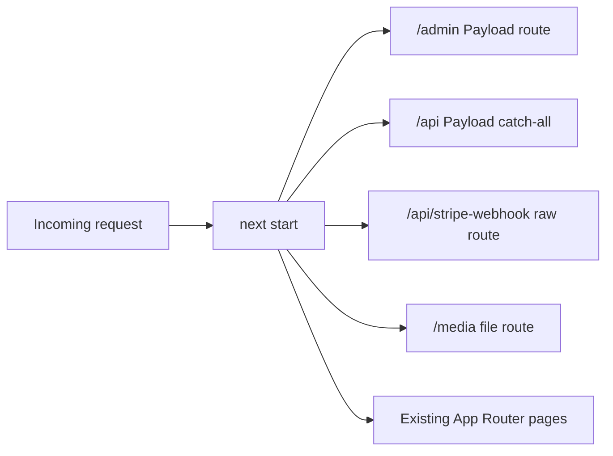

# Payload 2 to 3 migration

Move this app from Payload 2.30 on a custom Express server to Payload 3.94 on Next.js, preserving the public URLs, checkout, webhooks, media, admin customizations, and stored content. Rich text moves to Lexical in the same project so the later Payload 4 upgrade does not have to redo it.

Target the current stable line: **Payload 3.94.1**, **Next.js 16.4.6** (minimum 16.4.5), **React 19.2** in the peer range Payload accepts (the patched `~19.2.9` line), **Node `^22.23.5` or newer supported by 3.94**. Stay on MongoDB. Do not install Payload 4.

Payload 3 deletes the Express admin/API server. The public site already lives in the App Router, so the frontend routes stay; the process that serves them changes.

## Checklist

- [ ] Pin Payload 3.94.1, Next 16.4.6, React 19.2, and Node 22.23.5+; back up Mongo
- [ ] Replace the Express server with withPayload route handlers, next dev/build/start, and instrumentation cron
- [ ] Keep `/media` file URLs and a raw-body Stripe webhook route
- [ ] Port custom endpoints, audio upload, rate limit, email adapter, and loginAfterCreate to the Payload 3 request API
- [ ] Move rich text to Lexical, convert the button node, then migrate stored Slate JSON
- [ ] Fix Next 16 and React 19.2 breakages in the existing App Router site
- [ ] Verify pages, admin, preview, media, checkout, webhook, cron endpoints, and production build

## What must keep working

- Public paths: `/`, `/[slug]`, `/admin`, `/api/*`, `/media/*`, `/next/preview`, `/next/revalidate`, `/next/exit-preview`, `/api/audio`, `/api/sounds`.
- Checkout: `POST /api/checkout/ticket-buyer-questions`, `POST /api/create-payment-intent`, `GET /api/payment-status`, `POST /api/ensure-order-created`.
- Stripe webhook signature checks on the raw body (`src/server.ts` lines 20–22, `src/payload/endpoints/stripeWebhook.ts`).
- Cron loop that hits ticket sync and fee backfill (`src/payload/services/stripeTicketSalesCron.ts`).
- Cookie `payload-token`, `Authorization: JWT …`, and `users API-Key …` used by `src/app/_api` and the dashboard.
- Upload URLs under `/media` from `MEDIA_DIR` (`src/payload/collections/Media.ts`).
- Deploy health check `GET /api/health` on port 3000 (`serve-green` stays on 3001).
- Slate content already in Mongo, including the custom `button` element (`src/payload/fields/richTextButton/index.ts`), rendered by `src/app/_components/RichText/serialize.tsx` and `src/payload/utils/ticketEmailFooter.ts`.

Leave unused packages unwired: `@payloadcms/plugin-seo`, `plugin-redirects`, and `plugin-nested-docs` are in `package.json` but not in `src/payload/payload.config.ts`. Turning redirects on would change routing. Remove them after confirming `redirects.js` still tolerates a missing `/api/redirects`.

## 1. Runtime and branch

- Work on a migration branch. Take a full Mongo backup before any admin save of rich text and again before the Lexical write script.
- Raise Node everywhere the app runs: local, CI, and the deploy host. `Dockerfile` is `node:18.8-alpine` and points at a stale `dist/payload.config.js`; update it to the new `next start` entry and Node 22, or treat it as unused if production is only PM2 via `scripts/deploy.sh`.
- Pin Payload, `@payloadcms/*`, Next `16.4.6`, and React 19.2 to the same 3.94.1 set: `payload`, `@payloadcms/next`, `@payloadcms/db-mongodb`, `@payloadcms/richtext-lexical`, `@payloadcms/email-nodemailer`, `@payloadcms/ui`, `graphql`, `sharp`. Drop `@payloadcms/bundler-webpack`, `@payloadcms/richtext-slate`, the Slate pins, and `express` once nothing imports them.

## 2. Make Next the server

Replace `src/server.ts` and `src/server.default.ts`. Payload 3 boots through Next.

- Wrap `next.config.js` with `withPayload`.
- Add the generated route handlers: `src/app/(payload)/admin/[[...segments]]/page.tsx`, `src/app/(payload)/api/[...slug]/route.ts`, and the matching `layout.tsx` / `custom.scss` from a fresh `create-payload-app` (Mongo template), then point them at the existing config.
- Move `secret` from `payload.init` into the config. Delete `admin.bundler` and `admin.webpack`.
- Import `buildConfig` from `payload`, not `payload/config`. Collection types come from `payload`.
- Admin components become **file path strings** with `'use client'` where they use hooks. That covers `src/payload/components/Logo.tsx`, `Icon.tsx`, `SyncBandcampButton.tsx`, and `AudioSelectField.tsx`. Replace `payload/components/*` imports with `@payloadcms/ui`.
- Register email with `nodemailerAdapter` using the current SMTP env (`SMTP_HOST`, `SMTP_USER`, `SMTP_PASS`, from `hello@shush.dance`).
- Rewrite `rateLimit.skip` for a Web Request (`headers.get`, URL pathname). Keep the API-key and Stripe-webhook exemptions and `trustProxy: true`.
- Scripts: `dev` becomes `next dev`; `build` becomes `next build`; `serve` / `serve-green` become `next start -p 3000` and `-p 3001`. Next 16 uses Turbopack for both dev and build, so do not add `--turbopack` or `--webpack`. `next.config.js` has no custom webpack function. If `withPayload` injects one and `next build` refuses to start, follow the Payload 3.94 Next 16 template rather than opting out. Remove `PAYLOAD_CONFIG_PATH`, `build:payload`, and `build:server`. The temporary build listener on port 3999 goes away because `next build` loads Payload itself. The build host still needs `DATABASE_URI` and `PAYLOAD_SECRET`. Concurrent `next dev` and `next build` in one directory can corrupt the Turbopack cache; the deploy build must not run beside a live dev server on the same checkout.
- Start the Stripe ticket cron from `src/instrumentation.ts` (skip when `NEXT_PHASE` is build, or when `STRIPE_TICKET_SYNC_CRON_ENABLED=false`). Keep calling the existing localhost endpoints so behavior stays the same.

## 3. Preserve `/media` and the Stripe raw body

Payload 3 serves uploads at `/api/<collection>/file/<filename>` and drops `staticURL`. Existing files and stored URLs use `/media/...`.

- Keep `staticDir` as an absolute path from `MEDIA_DIR` or the repo `media` folder (`src/payload/paths.ts`) for Media, Audio, and Documents.
- Add a Next route that streams those files at the current `/media` prefix so public pages, emails, and `getMediaUrl` do not change.
- Put the Stripe webhook in `src/app/api/stripe-webhook/route.ts`, which reads `request.text()` and verifies the signature, then calls the existing order logic. Do not also register that path on the Payload catch-all, or Next/Payload will parse the body first. Keep the public URL `POST /api/stripe-webhook`.

## 4. Port endpoints and hooks

Rewrite every handler in `src/payload/endpoints` and the Audio `custom-upload` endpoint from `(req, res)` to Payload 3’s `(req) => Response`. Same paths, methods, and auth checks:

- Public checkout and payment endpoints stay unauthenticated.
- `x-api-key` checks stay on monitor, ticket sync, fee backfill, and the public tracker.
- `sync-bandcamp` stays callable from the admin button with the session cookie.
- Audio upload reads `req.formData()` instead of `req.files`.
- `createPaymentIntent` stops using `req.connection`; read the client IP from forwarded headers.

Update `src/payload/collections/Users/hooks/loginAfterCreate.ts`: `payload.login` no longer takes an Express `res`. Return the token the same way the API does today so a user created without a session still receives a logged-in response.

Regenerate `src/payload/payload-types.ts` with `payload generate:types` after the config compiles. Fix import sites that depend on the old type shape.

Bump `@payloadcms/live-preview-react` with Payload. Preview and revalidate routes stay; align the draft secret so Pages admin preview and `src/app/next/preview/route.ts` read the same env var (`NEXT_PRIVATE_DRAFT_SECRET` vs `PAYLOAD_PUBLIC_DRAFT_SECRET` is currently split).

## 5. Rich text: Slate JSON to Lexical

Do this inside the v3 migration. Slate still runs on 3.x but is removed in 4.0, and the stored JSON is not the same format.

- Replace `slateEditor` in `src/payload/payload.config.ts`, `src/payload/fields/createRichTextField.ts`, and `src/payload/collections/Media.ts` with `lexicalEditor`.
- Recreate the toolbar set the field has now: headings, link, lists, quote, bold, italic, and the custom **button** (internal link to `pages` or `documents`, same fields as `src/payload/fields/richTextLinkFields.ts`).
- Add a `SlateToLexicalFeature` converter for the `button` node and the stock nodes. Preview on read first (`afterRead` conversion, no writes). Confirm admin, `src/app/_components/RichText/serialize.tsx`, and ticket-email HTML.
- Then back up Mongo, set `disableHooks: true`, and run `migrateSlateToLexical`. Only after that, save documents in admin.
- Point the site serializer and the email HTML serializer at Lexical JSON. Keep the same visible output: headings, lists, links, and buttons.
- Drop `adminWebpack.ts` and the Slate overrides once nothing imports Slate.
- Remove `localized: true` on rich text unless localization is actually configured (it is not).

## 6. Next 14 to 16 and React 19.2

Payload 3.94.1 will not install against Next 14.2 or React 18. Next 16 removes the temporary sync compatibility that Next 15 still had. Run `npx @next/codemod@canary next-async-request-api .` after the dependency bump, then fix what it misses.

- Await request APIs. Sync access throws in 16. Known call sites: `cookies()` in `src/app/_utilities/getMeUser.ts` and `src/app/(pages)/dashboard/actions.ts`; `draftMode()` in `src/app/next/preview/route.ts` and `src/app/next/exit-preview/route.ts`; sync `params` in `src/app/(pages)/[slug]/page.tsx` and `src/app/(pages)/tracker/[slug]/page.tsx` (including `generateMetadata`).
- `revalidateTag` requires a cache-life profile. In `src/app/next/revalidate/route.ts`, call `revalidateTag(tag, 'max')` and keep the existing `revalidatePath` calls. Do not switch this route to `updateTag`; that API only works inside a Server Action, and publish still arrives as a GET from the Payload hook.
- Delete the empty `middleware.ts`. Next 16 deprecates that filename in favor of `proxy.ts`. An empty file should not be renamed into a no-op proxy.
- Remove `swcMinify` from `next.config.js`. Keep `csp.js` and `redirects.js` loaded from that config.
- Image defaults changed: local-IP optimization is blocked, `minimumCacheTTL` is 4 hours, and `qualities` defaults to `[75]`. This app optimizes `/media` on localhost when `NEXT_PUBLIC_MEDIA_URL` is unset (`next.config.js` `remotePatterns` includes `localhost:3000`). Set `images.dangerouslyAllowLocalIP` only if local optimized media must keep working. Leave production on `remotePatterns`. Do not enable `cacheComponents`.
- Lint stays on the existing ESLint flat config (`eslint.config.mjs`). `next lint` is gone; the `lint` script already calls `eslint` directly. Bump `@next/eslint-plugin-next` with Next 16.
- Re-test client components that touch the DOM (audio player, checkout, lightbox). Do not restyle them.

## 7. Verify before calling it done

Exercise these on a copy of production data, in the browser:

- Home, a CMS page, events, merch, releases, and a rich-text button link.
- Admin login, edit a page, drafts, live preview, and revalidate after publish.
- Media upload and an existing `/media/...` URL.
- Checkout through Stripe test mode, including buyer questions, then the success page.
- Webhook delivery with a signed raw body (Stripe CLI).
- Bandcamp sync button, dashboard sales and ticket sales, `/api/health`.
- Ticket email footer HTML from a converted rich-text field.
- `next build` with the database reachable, then `next start` on port 3000 and confirm deploy’s health check.
