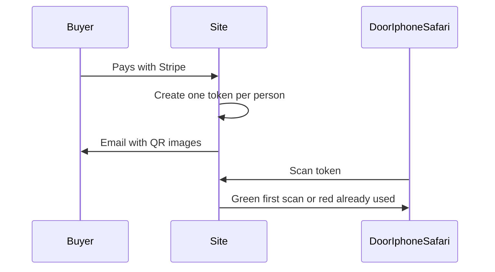

# QR ticket check-in

Keep selling tickets on the site. Issue one unguessable QR per person, email it, and scan it with a staff web page on an iPhone. Existing App Store QR apps cannot mark tickets used in this system.

## What exists today

Paid checkout already creates a `ticket-sales` record and emails a plain-text confirmation. The door copy says the buyer’s name goes on a list (`sendTicketEmails` in [`src/payload/utils/processStripeOrder.ts`](../src/payload/utils/processStripeOrder.ts)).

Each sale has one `ticketNumber` (for example `TICKET-{paymentIntentId}-{eventId}`) and a `status` of `active`, `used`, `cancelled`, or `refunded` ([`src/payload/collections/TicketSales/index.ts`](../src/payload/collections/TicketSales/index.ts)).

That status field is the right check-in switch. The current ticket number is the wrong thing to put in a QR code: one code covers the whole order, and the format is predictable enough to guess.

The same `ticketNumber` is minted in more than one place. All of them need the same admission records:

- [`src/payload/utils/processStripeOrder.ts`](../src/payload/utils/processStripeOrder.ts)
- [`src/payload/endpoints/stripeWebhookSimple.ts`](../src/payload/endpoints/stripeWebhookSimple.ts)
- [`src/payload/endpoints/createOrder.ts`](../src/payload/endpoints/createOrder.ts)
- [`src/payload/endpoints/stripeBackfillTicketSales.ts`](../src/payload/endpoints/stripeBackfillTicketSales.ts)
- [`src/payload/utils/importPaidCheckoutSession.ts`](../src/payload/utils/importPaidCheckoutSession.ts)

## Recommended setup

Issue **one admission per person**, not per order. If someone buys 3 tickets, they get 3 QR codes. Each code is a random token (about 128 bits) stored on the sale, not the human-readable ticket number.

The QR image encodes a URL such as `https://shush.dance/t/{token}`. The buyer email in `sendTicketEmails` embeds the QR images (inline PNG). The same page is a simple ticket view: event, name, tier, and the code, so a screenshot still works if the email images fail.

On scan, the server does one atomic update:

- token exists and belongs to this event
- status is `active` and payment is paid
- set status to `used`, store `scannedAt`

A second scan returns “already used at 23:14”, not a second entry. Cancelled and refunded codes stay red.

Do not use the iPhone Camera app as the door tool. It only shows the URL. It cannot flip `status` or stop a screenshot from being reused.

## Do you need an iOS app?

No, for a normal door with phone signal or venue wifi.

**Generic QR reader apps** (App Store “QR scanner” apps and the Camera app) only decode the text. They do not know the ticket database.

**Organizer apps** (Eventbrite Organizer, RA, Dice, Tito, Ticket Tailor) only scan tickets sold on that platform. They will not check codes generated in Payload.

**Spreadsheet scanners** (Orca Scan and similar) can beep against an exported list. They will not update `ticket-sales`, refunds, or “already scanned” unless a second copy of the guest list is kept in sync. That drifts on the night.

The version that stays on this stack is a **staff page in Safari** on the door iPhone: log in (existing Payload admin or a door PIN), pick the event, camera scans, full-screen green or red with name and tier. iOS Safari can scan QR codes from the page (`BarcodeDetector` on current iOS, with a small JS scanner fallback). No App Store build, no Apple Developer account.

Build a native app only if the door has **no signal** and offline scanning is required. A phone web page needs a network call to mark the ticket used. Offline means a small staff app (or pretix + pretixSCAN) that downloads the token list before doors and syncs scans later. That is a separate product, and the wrong first step if the venue has LTE or wifi.

Apple Wallet / Google Wallet is optional later. The pass still contains the same QR; Wallet does not scan it. It only makes the buyer’s ticket easier to open. It needs an Apple Developer account and a pass certificate.

## Implementation checklist

- [ ] Add admissions on the ticket sale: token, tier, holder name, `scannedAt`. Split `quantity` into one row per person in every sale-creation path listed above.
- [ ] Public ticket page at `/t/{token}` that shows event, name, tier, and the QR.
- [ ] Staff-only scan page: event picker, camera, full-screen green/red with name and tier.
- [ ] Check-in endpoint that updates `status` to `used` once and returns “already used” on a second scan. Reject cancelled and refunded tokens.
- [ ] Confirmation email: inline QR images, replacing “your name will be on the list”.
- [ ] Show scan result (`scannedAt`, used vs still active) on the existing ticket sales dashboard so a refund after doors is visible.

Guest list by name can stay as a backup export for the first events. The QR is the source of truth once staff are scanning.
